# Kirana Ledger: Architectural Decisions & Implementation Explanation

## Deep-Dive Analysis: Why, What, How, and Why Not

**Project:** Kirana Ledger (`store-ledger`)  
**Target Platform:** Android (Google Play Closed Testing) + Node.js/PostgreSQL Server  
**Frontend Framework:** React Native (Expo Development Builds, Expo Router, TypeScript Strict)  
**Backend Framework:** Node.js (Fastify, TypeScript Strict, PostgreSQL)  
**Author:** Roshan Kumar  
**Companion File:** [`IMPLEMENTATION_PLAN.md`](IMPLEMENTATION_PLAN.md)  
**Source Specs:** `kirana-ledger-spec-v2.md` & `kirana-ledger-tickets-v2.md`

---

## Table of Contents

- [1. Database ER-Diagram & Relational Architecture](#1-database-er-diagram--relational-architecture)
- [2. Complete Database Schemas (SQLite & PostgreSQL)](#2-complete-database-schemas-sqlite--postgresql)
- [3. System Paradigm: Offline-First vs Cloud-First Architecture](#3-system-paradigm-offline-first-vs-cloud-first-architecture)
- [4. Monorepo Structure & Package Boundary Isolation](#4-monorepo-structure--package-boundary-isolation)
- [5. Financial & Inventory Modeling: Append-Only Event Streams](#5-financial--inventory-modeling-append-only-event-streams)
- [6. Numeric Representation: Integer Paise & Integer Milli-Units](#6-numeric-representation-integer-paise--integer-milli-units)
- [7. Identifier Strategy: Client-Generated UUIDv7 vs Server Sequences](#7-identifier-strategy-client-generated-uuidv7-vs-server-sequences)
- [8. Global Serialization: Per-Shop Sequence Counter with Row Locking](#8-global-serialization-per-shop-sequence-counter-with-row-locking)
- [9. Transactional Outbox & Push Protocol: Per-Op Savepoints & Op Isolation](#9-transactional-outbox--push-protocol-per-op-savepoints--op-isolation)
- [10. Master Data Conflicts: BaseSeq & Field-Level Metadata](#10-master-data-conflicts-baseseq--field-level-metadata)
- [11. Pull Protocol & Relational Consistency: Op-Complete Paging Boundaries](#11-pull-protocol--relational-consistency-op-complete-paging-boundaries)
- [12. Client Concurrency Coordination: SQLite DB Lease vs In-Memory Mutex](#12-client-concurrency-coordination-sqlite-db-lease-vs-in-memory-mutex)
- [13. Inventory Reconciliation: Server-Calculated STOCK_COUNT vs Client Deltas](#13-inventory-reconciliation-server-calculated-stock_count-vs-client-deltas)
- [14. Authentication Security: Token Rotation with 10-Second Grace Window](#14-authentication-security-token-rotation-with-10-second-grace-window)
- [15. Multi-Tenant Database Isolation: Composite Foreign Keys](#15-multi-tenant-database-isolation-composite-foreign-keys)
- [16. Query Safety & SQL Injection Defense: Allowlisted Patch Builders vs ORMs](#16-query-safety--sql-injection-defense-allowlisted-patch-builders-vs-orms)
- [17. Mobile Storage Engine: Hand-Written SQLite WAL vs WatermelonDB/Realm](#17-mobile-storage-engine-hand-written-sqlite-wal-vs-watermelondbrealm)
- [18. Android Native Diagnostics: Kotlin Module (Doze & App Standby Inspection)](#18-android-native-diagnostics-kotlin-module-doze--app-standby-inspection)
- [19. Summary Architectural Decision Matrix](#19-summary-architectural-decision-matrix)

---

## 1. Database ER-Diagram & Relational Architecture

The system enforces relational integrity across 12 distinct entities. Multi-tenancy is enforced at the database level via composite primary and foreign keys `(shop_id, id)`.

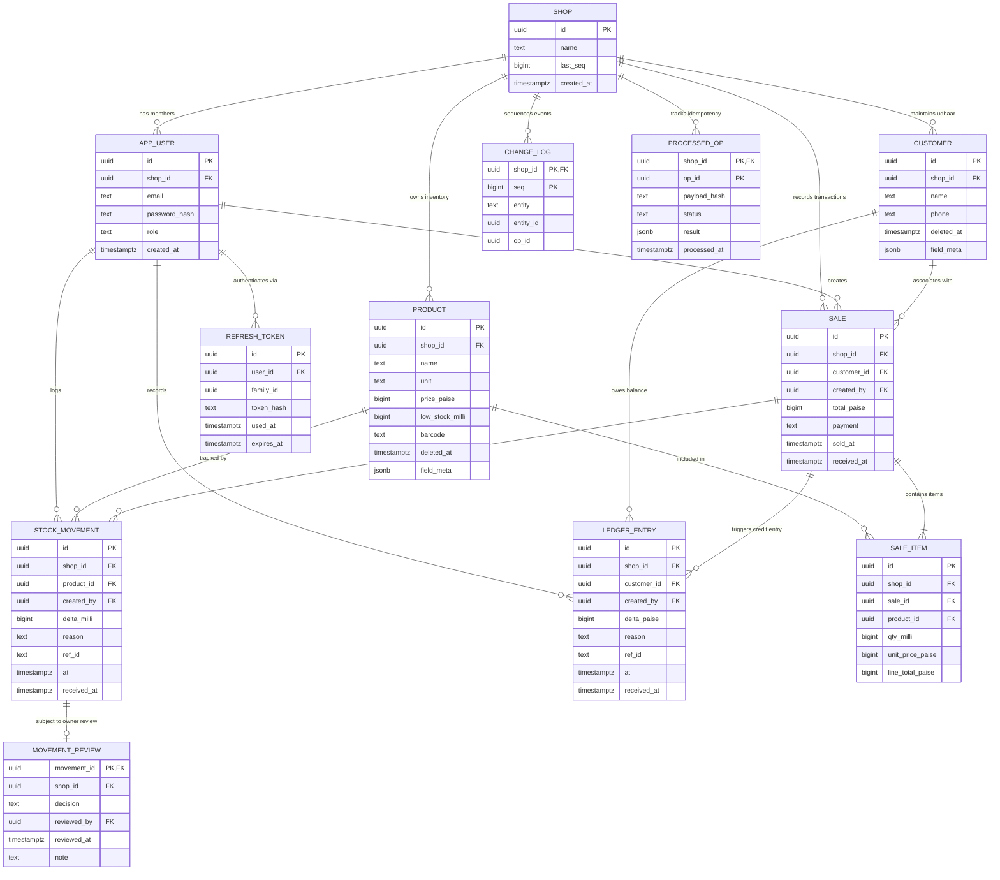

---

## 2. Complete Database Schemas (SQLite & PostgreSQL)

### 2.1 Client Schema (SQLite)

Located in `apps/mobile/src/db/`:

- **PRAGMA journal_mode = WAL:** Ensures write transactions do not block reads from FlashList UI.
- **No client foreign keys:** Pull sync pages can deliver entities in arbitrary order across batch boundaries. Relational integrity is guaranteed by the server.
- **No CHECK enums:** Altering tables with enum CHECKs in SQLite migrations is brittle across mobile OS upgrades; validation is handled by Zod.

```sql
PRAGMA journal_mode = WAL;

CREATE TABLE product (
  id TEXT PRIMARY KEY,
  name TEXT NOT NULL,
  unit TEXT NOT NULL,
  price_paise INTEGER NOT NULL CHECK (price_paise >= 0),
  low_stock_milli INTEGER NOT NULL DEFAULT 0,
  barcode TEXT,
  deleted_at INTEGER
);

CREATE TABLE customer (
  id TEXT PRIMARY KEY,
  name TEXT NOT NULL,
  phone TEXT,
  deleted_at INTEGER
);

CREATE TABLE sale (
  id TEXT PRIMARY KEY,
  customer_id TEXT,
  created_by TEXT NOT NULL,
  total_paise INTEGER NOT NULL CHECK (total_paise >= 0),
  payment TEXT NOT NULL,
  sold_at INTEGER NOT NULL
);

CREATE TABLE sale_item (
  id TEXT PRIMARY KEY,
  sale_id TEXT NOT NULL,
  product_id TEXT NOT NULL,
  qty_milli INTEGER NOT NULL CHECK (qty_milli > 0),
  unit_price_paise INTEGER NOT NULL,
  line_total_paise INTEGER NOT NULL
);

CREATE TABLE stock_movement (
  id TEXT PRIMARY KEY,
  product_id TEXT NOT NULL,
  created_by TEXT NOT NULL,
  delta_milli INTEGER NOT NULL CHECK (delta_milli <> 0),
  reason TEXT NOT NULL,
  ref_id TEXT,
  at INTEGER NOT NULL
);

CREATE TABLE ledger_entry (
  id TEXT PRIMARY KEY,
  customer_id TEXT NOT NULL,
  created_by TEXT NOT NULL,
  delta_paise INTEGER NOT NULL CHECK (delta_paise <> 0),
  reason TEXT NOT NULL,
  ref_id TEXT,
  at INTEGER NOT NULL
);

CREATE TABLE movement_review (
  movement_id TEXT PRIMARY KEY,
  decision TEXT NOT NULL,
  reviewed_by TEXT NOT NULL,
  reviewed_at INTEGER NOT NULL,
  note TEXT
);

CREATE INDEX ix_sm_product ON stock_movement(product_id);
CREATE INDEX ix_le_customer ON ledger_entry(customer_id);
CREATE INDEX ix_si_sale ON sale_item(sale_id);
CREATE INDEX ix_sale_time ON sale(sold_at);

CREATE TABLE outbox (
  local_seq INTEGER PRIMARY KEY AUTOINCREMENT,
  op_id TEXT NOT NULL UNIQUE,
  type TEXT NOT NULL,
  payload TEXT NOT NULL,
  state TEXT NOT NULL DEFAULT 'PENDING',
  attempts INTEGER NOT NULL DEFAULT 0,
  next_retry_at INTEGER NOT NULL DEFAULT 0,
  last_error TEXT
);

CREATE TABLE sync_state (
  key TEXT PRIMARY KEY,
  value TEXT NOT NULL
);

CREATE TABLE sync_log (
  id INTEGER PRIMARY KEY AUTOINCREMENT,
  started_at INTEGER,
  duration_ms INTEGER,
  pushed INTEGER,
  pulled INTEGER,
  bytes INTEGER,
  error TEXT
);
```

### 2.2 Server Schema (PostgreSQL)

Located in `apps/server/src/migrations/`:

- **Composite Foreign Keys:** `(shop_id, id)` composite uniqueness guarantees tenant isolation at the database level.
- **Immutable Timestamps:** `received_at` stores the exact server UTC arrival time, decoupling displayed device time (`sold_at`) from event ordering.
- **`field_meta` JSONB:** Stores per-column `{ seq, deviceId }` metadata for master data conflict detection.

```sql
CREATE EXTENSION IF NOT EXISTS "uuid-ossp";

CREATE TABLE shop (
  id uuid PRIMARY KEY,
  name text NOT NULL CHECK (char_length(name) BETWEEN 1 AND 120),
  last_seq bigint NOT NULL DEFAULT 0,
  created_at timestamptz NOT NULL DEFAULT now()
);

CREATE TABLE app_user (
  id uuid PRIMARY KEY,
  shop_id uuid NOT NULL REFERENCES shop(id) ON DELETE CASCADE,
  email text NOT NULL CHECK (char_length(email) <= 254),
  password_hash text NOT NULL,
  role text NOT NULL DEFAULT 'OWNER' CHECK (role IN ('OWNER','EMPLOYEE')),
  created_at timestamptz NOT NULL DEFAULT now(),
  UNIQUE (shop_id, id)
);
CREATE UNIQUE INDEX ux_user_email ON app_user (lower(email));

CREATE TABLE refresh_token (
  id uuid PRIMARY KEY,
  user_id uuid NOT NULL REFERENCES app_user(id) ON DELETE CASCADE,
  family_id uuid NOT NULL,
  token_hash text NOT NULL,
  used_at timestamptz,
  expires_at timestamptz NOT NULL
);
CREATE INDEX ix_rt_hash ON refresh_token (token_hash);

CREATE TABLE product (
  id uuid PRIMARY KEY,
  shop_id uuid NOT NULL REFERENCES shop(id) ON DELETE CASCADE,
  name text NOT NULL CHECK (char_length(name) BETWEEN 1 AND 120),
  unit text NOT NULL CHECK (unit IN ('pc','kg','l')),
  price_paise bigint NOT NULL CHECK (price_paise BETWEEN 0 AND 100000000),
  low_stock_milli bigint NOT NULL DEFAULT 0 CHECK (low_stock_milli >= 0),
  barcode text CHECK (char_length(barcode) <= 64),
  deleted_at timestamptz,
  field_meta jsonb NOT NULL DEFAULT '{}',
  UNIQUE (shop_id, id)
);

CREATE TABLE customer (
  id uuid PRIMARY KEY,
  shop_id uuid NOT NULL REFERENCES shop(id) ON DELETE CASCADE,
  name text NOT NULL CHECK (char_length(name) BETWEEN 1 AND 120),
  phone text CHECK (char_length(phone) <= 20),
  deleted_at timestamptz,
  field_meta jsonb NOT NULL DEFAULT '{}',
  UNIQUE (shop_id, id)
);

CREATE TABLE sale (
  id uuid PRIMARY KEY,
  shop_id uuid NOT NULL REFERENCES shop(id) ON DELETE CASCADE,
  customer_id uuid,
  created_by uuid NOT NULL,
  total_paise bigint NOT NULL CHECK (total_paise BETWEEN 0 AND 100000000),
  payment text NOT NULL CHECK (payment IN ('CASH','UPI','CREDIT')),
  sold_at timestamptz NOT NULL,
  received_at timestamptz NOT NULL DEFAULT now(),
  UNIQUE (shop_id, id),
  FOREIGN KEY (shop_id, customer_id) REFERENCES customer (shop_id, id),
  FOREIGN KEY (shop_id, created_by) REFERENCES app_user (shop_id, id)
);

CREATE TABLE sale_item (
  id uuid PRIMARY KEY,
  shop_id uuid NOT NULL,
  sale_id uuid NOT NULL,
  product_id uuid NOT NULL,
  qty_milli bigint NOT NULL CHECK (qty_milli > 0),
  unit_price_paise bigint NOT NULL CHECK (unit_price_paise >= 0),
  line_total_paise bigint NOT NULL CHECK (line_total_paise >= 0),
  FOREIGN KEY (shop_id, sale_id) REFERENCES sale (shop_id, id) ON DELETE CASCADE,
  FOREIGN KEY (shop_id, product_id) REFERENCES product (shop_id, id)
);

CREATE TABLE stock_movement (
  id uuid PRIMARY KEY,
  shop_id uuid NOT NULL REFERENCES shop(id) ON DELETE CASCADE,
  product_id uuid NOT NULL,
  created_by uuid NOT NULL,
  delta_milli bigint NOT NULL CHECK (delta_milli <> 0),
  reason text NOT NULL CHECK (reason IN ('SALE','PURCHASE','ADJUSTMENT','COUNT')),
  ref_id text,
  at timestamptz NOT NULL,
  received_at timestamptz NOT NULL DEFAULT now(),
  UNIQUE (shop_id, id),
  FOREIGN KEY (shop_id, product_id) REFERENCES product (shop_id, id),
  FOREIGN KEY (shop_id, created_by) REFERENCES app_user (shop_id, id)
);

CREATE TABLE ledger_entry (
  id uuid PRIMARY KEY,
  shop_id uuid NOT NULL REFERENCES shop(id) ON DELETE CASCADE,
  customer_id uuid NOT NULL,
  created_by uuid NOT NULL,
  delta_paise bigint NOT NULL CHECK (delta_paise <> 0),
  reason text NOT NULL CHECK (reason IN ('CREDIT_SALE','PAYMENT','ADJUSTMENT')),
  ref_id text,
  at timestamptz NOT NULL,
  received_at timestamptz NOT NULL DEFAULT now(),
  UNIQUE (shop_id, id),
  FOREIGN KEY (shop_id, customer_id) REFERENCES customer (shop_id, id),
  FOREIGN KEY (shop_id, created_by) REFERENCES app_user (shop_id, id)
);

CREATE TABLE movement_review (
  movement_id uuid PRIMARY KEY,
  shop_id uuid NOT NULL,
  decision text NOT NULL CHECK (decision IN ('APPROVED','REJECTED')),
  reviewed_by uuid NOT NULL,
  reviewed_at timestamptz NOT NULL DEFAULT now(),
  note text,
  FOREIGN KEY (shop_id, movement_id) REFERENCES stock_movement (shop_id, id) ON DELETE CASCADE,
  FOREIGN KEY (shop_id, reviewed_by) REFERENCES app_user (shop_id, id)
);

CREATE TABLE change_log (
  shop_id uuid NOT NULL REFERENCES shop(id) ON DELETE CASCADE,
  seq bigint NOT NULL,
  entity text NOT NULL,
  entity_id uuid NOT NULL,
  op_id uuid NOT NULL,
  PRIMARY KEY (shop_id, seq)
);

CREATE TABLE processed_op (
  shop_id uuid NOT NULL REFERENCES shop(id) ON DELETE CASCADE,
  op_id uuid NOT NULL,
  payload_hash text NOT NULL,
  status text NOT NULL,
  result jsonb NOT NULL,
  processed_at timestamptz NOT NULL DEFAULT now(),
  PRIMARY KEY (shop_id, op_id)
);
```

---

## 3. System Paradigm: Offline-First vs Cloud-First Architecture

### What

A local-first architecture where the React Native mobile application reads from and writes to a local SQLite database embedded on the device. All business operations commit synchronously to the local SQLite database. A background sync engine (`sync-core`) asynchronously synchronizes local state with a central PostgreSQL database via an outbox queue when internet connectivity is available.

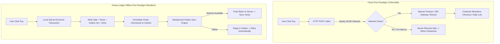

### Why

- **Kirana Store Realities:** Retail kirana shops in India frequently operate in basement shops, dense urban concrete alleys, or semi-rural areas with fluctuating 2G/3G connectivity or intermittent power outages.
- **Checkout Latency SLA:** A customer waiting at a kirana counter expects checkout to complete in under 500 milliseconds. A cloud-dependent request that blocks on HTTP round-trips causes counter queues, customer disputes, and transaction abandonment.
- **Autonomous Survivability:** The store must remain 100% functional for days without internet connectivity without losing a single sale, credit record, or inventory update.

### How

1. **Local Write Path:** The UI triggers a repository function. The repository opens an exclusive SQLite transaction, inserts business records (`sale`, `sale_item`, `stock_movement`), and inserts an op record into `outbox` in the same transaction.
2. **Immediate Return:** The transaction commits locally, and the UI immediately updates via TanStack Query invalidation (latency < 10ms).
3. **Async Synchronization:** The `sync-core` runner wakes up via reactive triggers (network reconnected, app foregrounded, debounced write) and pushes pending outbox batches to `POST /sync/push`.
4. **Pull Ingestion:** The client queries `GET /sync/pull`, receives changes from other devices in the store, and applies them locally using `INSERT OR IGNORE` and idempotent upserts.

### Why Not

- **Why not Cloud-First with an HTTP Cache (Apollo / React Query offline cache)?**  
  HTTP caching is read-only. It cannot safely stage complex relational writes (e.g. atomic sale + inventory reduction + credit ledger update) offline. Storing mutations in a generic cache queue lacks relational integrity, crash-safety, and queryability.
- **Why not Firebase / Firestore?**  
  Firestore's offline persistence has uncontrollable synchronization semantics, high latency on cold starts, lacks support for explicit ACID transactions across multiple collections when offline, cannot enforce server-side business validation on individual operations in a batch without cloud functions, and locks the architecture into proprietary infrastructure with escalating operational costs.
- **Why not CouchDB / PouchDB?**  
  PouchDB operates with document-level revision trees (`_rev`). Resolving conflicts across document trees requires complex custom merge logic, consumes excessive disk space on mobile devices for revision histories, and performs poorly on complex relational aggregations (such as `SUM(paise)` across 50,000 ledger entries).

---

## 4. Monorepo Structure & Package Boundary Isolation

### What

A `pnpm` monorepo organized into two application packages (`apps/mobile`, `apps/server`) and two shared packages (`packages/shared`, `packages/sync-core`).

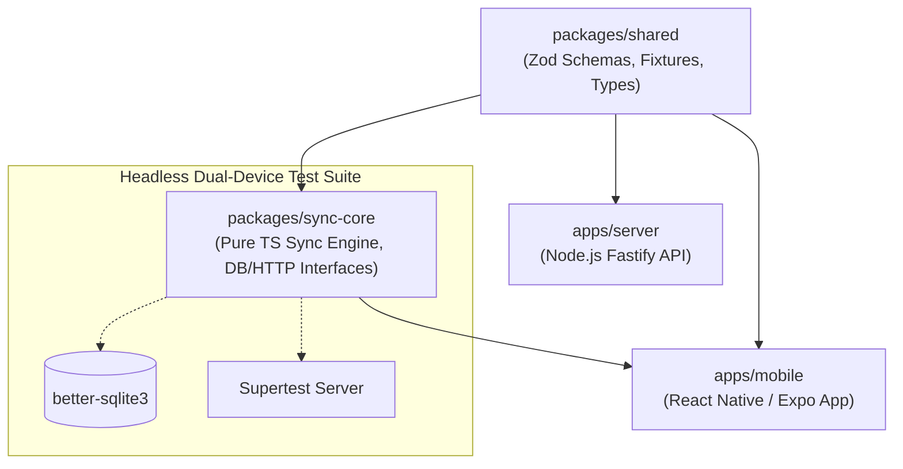

### Why

- **Contract Drift Prevention:** Discrepancies between mobile client serialization and server deserialization are the #1 cause of silent sync failures. Having a single shared package (`packages/shared`) guarantees that Zod validation schemas, reject reason codes, and numeric boundaries are identical on both ends.
- **Deterministic Headless Testing:** The core sync state machine (`packages/sync-core`) contains complex distributed systems logic (backoff, lease coordination, op-isolation, cursor management). Placing this logic in a pure TypeScript package allows running multi-device simulation tests in Jest in milliseconds without booting React Native or an Android emulator.

### How

- `packages/shared` exports:
  - Zod `.strict()` schemas for every op payload (`ProductCreateSchema`, `CreateSaleSchema`, etc.).
  - Protocol constants: `PROTOCOL_VERSION = 1`, reject reason codes (`VALIDATION`, `TOTAL_MISMATCH`, etc.).
  - Static JSON fixtures (`packages/shared/fixtures/`) representing valid and invalid payloads used in unit tests on both client and server.
- `packages/sync-core` exposes an abstract `SyncEngine` class that accepts injected interfaces for `DatabaseAdapter` and `HttpClientAdapter`.
- `apps/mobile` implements these interfaces using `expo-sqlite` and `fetch`.
- Headless test suites implement these interfaces using `better-sqlite3` (in-memory) and supertest.

### Why Not

- **Why not Multi-Repo?**  
  Multi-repo architectures create dependency synchronization friction. A breaking change to an op payload requires updating the schema repo, publishing an npm package, updating the server, and updating the mobile app. In a monorepo, a contract change is a single atomic Git commit verified by CI across both consumers simultaneously.
- **Why not Nx or Turborepo heavy tooling?**  
  For a focused project with two apps and two packages, heavy build orchestrators introduce configuration bloat, proprietary caching abstractions, and slower onboarding. `pnpm` workspace protocol natively provides lightning-fast linking, symlink deduplication, and zero configuration overhead.

---

## 5. Financial & Inventory Modeling: Append-Only Event Streams

### What

Stock balances and Udhaar (credit) balances are **never** stored as mutable numeric columns in the database. Instead, every inventory change is recorded as an immutable row in `stock_movement` with a non-zero `delta_milli` and a `reason`, and every credit balance change is recorded as an immutable row in `ledger_entry` with a non-zero `delta_paise`. Balances are computed at query time via `SUM(delta)`.

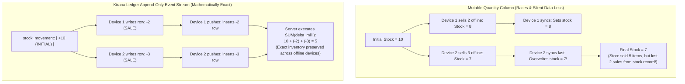

### Why

- **Multi-Device Offline Race Condition:** In a mutable model, whichever device syncs last blindly overwrites the column, causing silent data loss. In an append-only model, every sale movement survives.
- **Auditability & Legal Proof:** Udhaar disputes between shopkeepers and customers are common. An editable balance column cannot prove how a debt was incurred. An append-only ledger provides an irrefutable, timestamped paper trail of every item sold on credit and every partial payment made.

### How

Derived queries compute current balances on demand:

```sql
-- Compute current real-time stock
SELECT p.*, COALESCE(SUM(m.delta_milli), 0) AS stock_milli
FROM product p
LEFT JOIN stock_movement m ON m.product_id = p.id
  AND NOT EXISTS (
    SELECT 1 FROM movement_review r
    WHERE r.movement_id = m.id AND r.decision = 'REJECTED'
  )
WHERE p.deleted_at IS NULL
GROUP BY p.id;

-- Compute customer outstanding udhaar
SELECT customer_id, SUM(delta_paise) AS owed_paise
FROM ledger_entry
GROUP BY customer_id
HAVING owed_paise <> 0;
```

### Why Not

- **Why not a mutable `stock_quantity` column with a compensating log?**  
  Maintaining dual truth (a cached balance column plus a log) creates the dual-write problem. A transaction crash or concurrency bug can cause the balance column to diverge from the log sum. Having a single source of truth (`stock_movement`) eliminates reconciliation bugs entirely.
- **Why not Distributed Two-Phase Commit (2PC) or Locks?**  
  Distributed locks require active network connections. Because devices operate in airplane mode for hours or days, locking inventory on a remote server during checkout is physically impossible.

---

## 6. Numeric Representation: Integer Paise & Integer Milli-Units

### What

- **Currency:** Stored and computed as **integers representing Paise** (₹1 = 100 paise).
- **Quantities:** Stored and computed as **integers representing Milli-units** (1 kg = 1,000 milli-units, 0.250 kg = 250 milli-units).

### Why

- **Floating-Point Imprecision:** IEEE 754 floating-point numbers cannot accurately represent decimal fractions:
  ```js
  0.1 + 0.2 = 0.30000000000000004
  19.99 * 100 = 1998.9999999999998
  ```
  In a financial ledger, rounding discrepancies accumulate over hundreds of sales, causing the balance sheet to fail reconciliation audits.
- **Fractional Weight Precision:** Kirana customers routinely purchase fractional weights (e.g. 250 grams of jeera, 100 ml of mustard oil). Storing 250 grams as `250` integer milli-units guarantees exactness.

### How

- Line item total calculation follows the explicit rounding rule:
  $$\text{line\_total\_paise} = \left\lfloor \frac{\text{qty\_milli} \times \text{unit\_price\_paise}}{1000} + 0.5 \right\rfloor$$
- In TypeScript:
  ```ts
  export function calculateLineTotal(qtyMilli: number, unitPricePaise: number): number {
    return Math.floor((qtyMilli * unitPricePaise + 500) / 1000);
  }
  ```
- Sale total is the exact mathematical sum of line totals:
  ```ts
  export function calculateSaleTotal(items: { lineTotalPaise: number }[]): number {
    return items.reduce((acc, item) => acc + item.lineTotalPaise, 0);
  }
  ```
- Server-side validation recalculates this formula for every item in `CREATE_SALE` and rejects the payload with `TOTAL_MISMATCH` if client values diverge by even 1 paisa.

### Why Not

- **Why not `DECIMAL` / `NUMERIC` types in SQLite?**  
  SQLite has dynamic typing and does not natively implement arbitrary-precision decimal math in core C code; it stores `NUMERIC` as text, integers, or floating-point approximations depending on context. Using integer columns with mathematical constraints guarantees uniform behavior across SQLite, PostgreSQL, and JavaScript runtimes.
- **Why not third-party BigNumber libraries (Big.js / Decimal.js)?**  
  BigNumber libraries introduce object allocation overhead, serialize poorly to JSON, and slow down UI rendering when rendering 5,000 products in a FlashList. 64-bit integers in PostgreSQL and standard JavaScript safe integers provide massive headroom without any performance penalty.

---

## 7. Identifier Strategy: Client-Generated UUIDv7 vs Server Sequences

### What

All primary keys for entities created on the mobile client are generated directly on the device using **UUIDv7**.

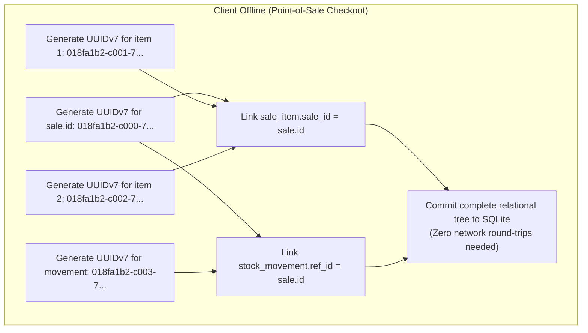

### Why

- **Offline Relational Tree Construction:** When a shopkeeper checks out a sale offline, the app must create child records referencing parent IDs before touching the network. Server-assigned sequences make this impossible.
- **B-Tree Locality & Index Performance:** Random UUIDv4 identifiers cause severe B-Tree fragmentation in SQLite and PostgreSQL because keys are scattered across random leaf pages, destroying cache locality. UUIDv7 embeds a 48-bit UNIX millisecond timestamp at the beginning of the 128-bit integer, ensuring sequential, time-ordered insertion.

### How

- In TypeScript: Generated using a monotonic UUIDv7 generator.
- On PostgreSQL: Stored natively as 16-byte `uuid` with clustered B-tree index performance matching standard auto-increment integers.

### Why Not

- **Why not Server-Assigned Auto-Increment Integers (`SERIAL`)?**  
  Impossible to assign while offline. Attempting to assign temporary client IDs (e.g. `temp_1`) and remapping them to permanent server IDs upon sync requires complex client-side foreign-key rewriting routines that are prone to race conditions and corruption upon app crash.
- **Why not UUIDv4?**  
  UUIDv4 has zero sequential ordering. In database indexes with over 100,000 rows, inserting random UUIDs forces the database engine to constantly swap index pages from disk to memory, increasing write I/O by orders of magnitude.

---

## 8. Global Serialization: Per-Shop Sequence Counter with Row Locking

### What

A strictly monotonically increasing integer sequence assigned to every mutation within a store. The sequence is managed via a dedicated `last_seq` counter on the `shop` table in PostgreSQL, incremented under a row lock (`SELECT ... FOR UPDATE`) inside the push transaction.

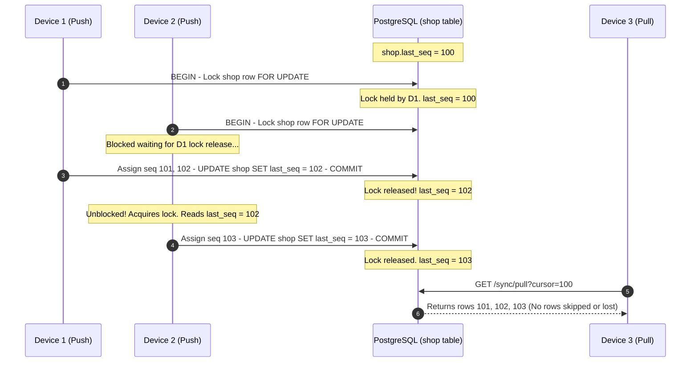

### Why

- **The "Missed-Row" Concurrency Trap:** With a global Postgres sequence or timestamps without row locking:
  1. Transaction A starts and takes seq 10.
  2. Transaction B starts, takes seq 11, and commits first.
  3. Client pulls up to seq 11 and stores cursor 11.
  4. Transaction A finally commits seq 10.
  5. Client pulls `WHERE seq > 11`. Row 10 is skipped forever!
- **Serialization Guarantee:** Holding an exclusive row lock on the `shop` record serializes all concurrent pushes for that shop, ensuring seq order equals commit order.

### How

```sql
BEGIN;
SELECT last_seq FROM shop WHERE id = $1 FOR UPDATE;
-- assign last_seq + 1, last_seq + 2, ... to all changes in this push
UPDATE shop SET last_seq = $new_last WHERE id = $1;
COMMIT;
```

### Why Not

- **Why not Timestamp-Based Synchronization (`updated_at > last_sync`)?**  
  Server and device clocks are subject to clock drift, NTP adjustments, and leap seconds. Two records committed in the same millisecond or out of clock sync order will cause missed updates.
- **Why not a Global Postgres Sequence without Row Locking?**  
  Global sequences in PostgreSQL do not participate in transaction rollbacks and do not guarantee commit order serialization. Concurrent transactions will commit out of sequence order, triggering the missed-row bug.

---

## 9. Transactional Outbox & Push Protocol: Per-Op Savepoints & Op Isolation

### What

The client records outgoing mutations in an `outbox` table within the same atomic transaction that updates local business data. The server processes push batches (`POST /sync/push`) by wrapping each operation in a nested transaction (`SAVEPOINT`). If an operation fails validation or database constraints, it rolls back only to that savepoint and records a deterministic `REJECTED` verdict without aborting the rest of the batch.

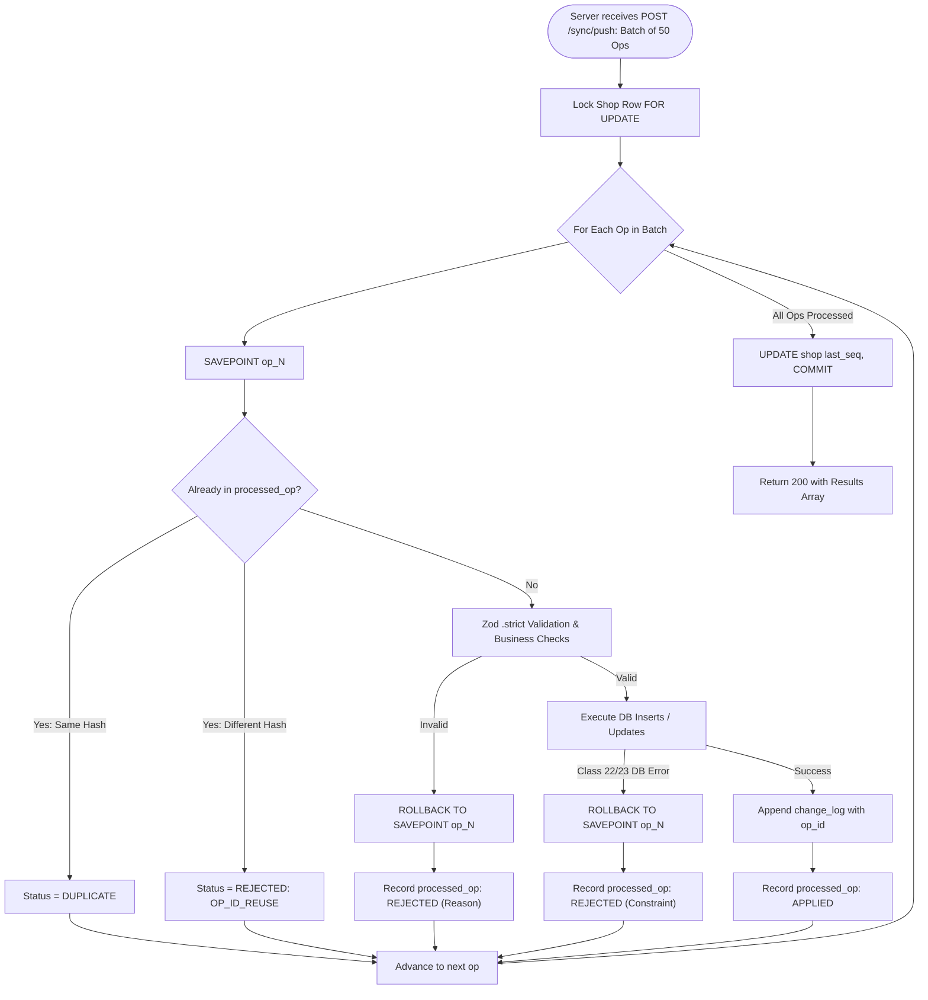

### Why

- **The "Poison Op" Queue-Blocking Vulnerability:** In a naive batch-push architecture (V1), if a client submits 10 sales and the 4th sale contains an invalid foreign key or corrupted payload, the entire HTTP transaction fails with a 500 or 400 error. The client leaves all 10 operations in its outbox and retries. The retry fails again. The queue is permanently jammed.
- **Network Crash Recovery:** If the network drops after the server commits but before the client receives the response, the client retries the same batch. The server recognizes previously processed ops via `processed_op` and returns `DUPLICATE` without re-executing business logic.

### How

- Client Op Isolation: If the client receives 3 consecutive 5xx errors for a batch, `sync-core` falls back to dispatching operations **singly (batch size = 1)**. An operation that fails 8 times alone is marked `STUCK`, unblocking the remaining queue and alerting the storekeeper.

### Why Not

- **Why not All-or-Nothing Atomic Batches?**  
  A single malformed operation permanently locks the outbox queue, rendering the mobile application incapable of synchronizing any future sales.
- **Why not Fire-and-Forget Pushes?**  
  Without acknowledgement and outbox deletion confirmation, network drops result in permanent data loss or massive duplicate creation.

---

## 10. Master Data Conflicts: BaseSeq & Field-Level Metadata

### What

A concurrency control protocol for mutable master data (`product`, `customer`). Every client update (`PRODUCT_PATCH`, `CUSTOMER_PATCH`) includes `id`, `baseSeq`, and `fields`. The server tracks per-column versioning in a JSONB column `field_meta` on the entity record.

```mermaid
flowchart TD
    StartPatch([Client sends PRODUCT_PATCH: baseSeq = 100, fields = { price_paise: 5500 }]) --> FetchMeta[Fetch current product & field_meta from DB]

    FetchMeta --> LoopFields{For each field in patch}
    LoopFields --> CheckMeta{"field_meta[f].seq > baseSeq?"}

    CheckMeta -->|"No: No concurrent edit"| ApplyField["Update column in DB<br>Set field_meta[f] = { seq: newSeq, deviceId }"]

    CheckMeta -->|"Yes: Concurrent edit detected"| CheckDevice{"field_meta[f].deviceId == req.deviceId?"}
    CheckDevice -->|"Yes: Same device offline sequence"| ApplyField
    CheckDevice -->|"No: Different device winner"| FlagConflict["Retain server value<br>Add field to conflicts array in response"]

    ApplyField --> NextField[Check next field]
    FlagConflict --> NextField
    NextField --> LoopFields

    LoopFields -->|"Done"| CommitMaster[Commit patch updates]
    CommitMaster --> ClientNotice["Client receives conflicts array:<br>Shows non-intrusive banner:<br>'Price changed on another device; your change was not applied'"]
```

### Why

- **Last-Writer-Wins (LWW) Data Loss:** If Phone A edits the price of "Toor Dal" while offline and Phone B edits the barcode and syncs first, a naive LWW model that replaces the entire row would overwrite Phone B's barcode with Phone A's stale row.
- **Non-Conflicting Merging:** Different fields edited concurrently should automatically merge without user intervention.
- **True Conflict Notification:** If both phones change the price concurrently, the server rejects the later edit, preserves the first committed price, and notifies the second user.

### Why Not

- **Why not Full Conflict-Free Replicated Data Types (CRDTs)?**  
  Full state-based or operation-based CRDTs introduce immense storage overhead and require complex garbage collection. Kirana store master data requires simple field merging with conflict alerting, which `field_meta` achieves with zero runtime libraries.
- **Why not Pessimistic Row Locking?**  
  Pessimistic locking requires holding open a database lock while a user fills out a form. On mobile devices that may go offline mid-edit, pessimistic locking is impossible.

---

## 11. Pull Protocol & Relational Consistency: Op-Complete Paging Boundaries

### What

The pull synchronization endpoint (`GET /sync/pull?cursor=N&limit=500`) streams change logs to the client. If a pagination limit falls in the middle of a composite operation, the server **automatically extends the page** to include all remaining records belonging to that same `op_id`.

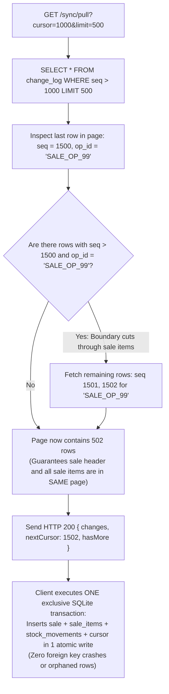

### Why

- **Foreign Key Violation During Sync Apply:** Client SQLite schemas maintain relational references. If Page 1 delivers a `sale_item` referencing a `sale_id` that is not delivered until Page 2, a client inserting Page 1 would fail with foreign key constraints, or leave the database in an inconsistent orphaned state if the app crashes between Page 1 and Page 2.
- **Atomic Business Transactions:** A sale and its corresponding stock deductions and credit entries represent a single atomic business reality. They must appear in the client's local database within the exact same SQLite transaction.

### Why Not

- **Why not Fixed-Limit Paging without Boundary Extension?**  
  Forces the client to disable foreign key checks, maintain an in-memory staging table for orphaned child records, and implement complex orphan reconciliation passes.
- **Why not Unbounded Pushes and Pulls (No Pagination)?**  
  A store recovering from a week without internet may have 10,000 pending change log entries. Attempting to transfer 10,000 records in a single JSON payload causes HTTP socket timeouts and out-of-memory crashes on low-end Android devices.

---

## 12. Client Concurrency Coordination: SQLite DB Lease vs In-Memory Mutex

### What

A database-backed lease mechanism implemented inside SQLite table `sync_state`. The sync coordinator acquires a lease before executing `syncOnce()`, periodically renews it while active, and releases it upon completion.

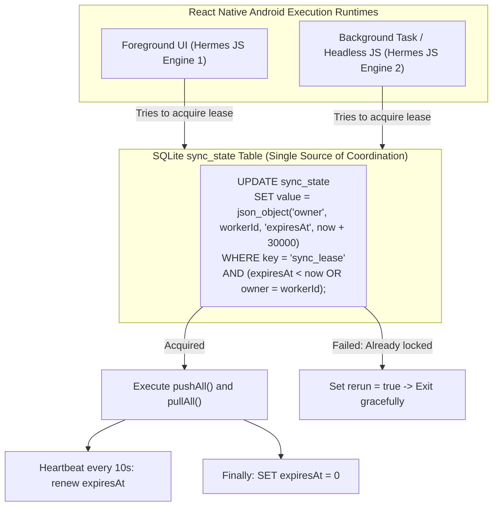

### Why

- **The Dual-Process JavaScript Execution Trap:** In modern React Native on Android, the foreground app and background headless tasks run in **separate, isolated JavaScript runtime instances** with separate heaps.
- **In-Memory Mutex Failure:** A standard JavaScript variable (`let isSyncing = false`) or in-memory promise mutex only exists within its own JavaScript heap. An in-memory lock fails completely, allowing the foreground and background workers to execute concurrent sync loops, causing SQLite database lock contention and duplicate network pushes.

### Why Not

- **Why not JavaScript In-Memory Mutex (e.g. `async-mutex`)?**  
  Fails across multi-runtime contexts (Foreground UI thread vs Background Headless Task), as proven above.
- **Why not File-System Lock (`.lock` file)?**  
  File creation and deletion on Android flash storage is subject to file-system caching, lacks atomic compare-and-swap primitives, and leaves stale locks on app kill that require complex manual recovery.

---

## 13. Inventory Reconciliation: Server-Calculated STOCK_COUNT vs Client Deltas

### What

When a shopkeeper performs a physical stock count, the mobile client emits an op of type `STOCK_COUNT` carrying `{ productId, countedMilli }`. The **server** computes the adjustment delta at the moment the op is applied:
$$\text{delta} = \text{countedMilli} - \sum(\text{stock\_movement})$$
The server records this delta as a new movement row with reason `COUNT`.

```mermaid
flowchart TD
    subgraph StaleDelta["Client-Computed Delta (Broken)"]
        S1["Phone A offline: Local stock shows 20"]
        S2["Shopkeeper counts 15 bottles"]
        S3["Phone A calculates delta = 15 - 20 = -5"]
        S4["Meanwhile, Phone B sold 5 bottles online: Server stock is ALREADY 15"]
        S5["Phone A syncs: applies delta of -5"]
        S6["Final Server Stock = 15 - 5 = 10 (ERROR: Double-decremented!)"]
        S1 --> S2 --> S3 --> S4 --> S5 --> S6
    end

    subgraph ServerDelta["Kirana Ledger STOCK_COUNT (Exact)"]
        K1["Phone A offline: Shopkeeper counts 15 bottles"]
        K2["Phone A sends op: STOCK_COUNT { countedMilli: 15000 }"]
        K3["Server locks shop & executes SUM(delta_milli) for product"]
        K4["Current server sum = 15000 (because Phone B sold 5)"]
        K5["Server computes adjustment: 15000 - 15000 = 0 delta"]
        K6["No spurious movement inserted; true stock remains 15"]
        K1 --> K2 --> K3 --> K4 --> K5 --> K6
    end
```

### Why

- **The Stale Offline Audit Problem:** A phone offline for 3 days has a stale stock sum. If it sent a client-calculated delta, it would double-deduct sales that occurred on other phones while it was offline.
- **Server Authority on Snapshot Reconciliation:** Physical counts represent an absolute point-in-time ground truth. The delta necessary to reach that truth can only be computed against the central, real-time aggregate of all devices.

### Why Not

- **Why not compute the delta on the client?**  
  As proven above, computing deltas against stale local stock causes massive inventory distortion whenever multiple devices operate concurrently.
- **Why not hard-overwrite a `stock_quantity` column?**  
  Destroys the append-only mathematical property of the ledger and violates auditability.

---

## 14. Authentication Security: Token Rotation with 10-Second Grace Window

### What

Authentication uses short-lived JWT access tokens (15-minute lifespan) and long-lived rotating refresh tokens (30-day lifespan). Refresh tokens are 256-bit cryptographically secure random numbers stored only as SHA-256 hashes in PostgreSQL. Each refresh request issues a new refresh token and invalidates the previous one, with a **10-second grace window**.

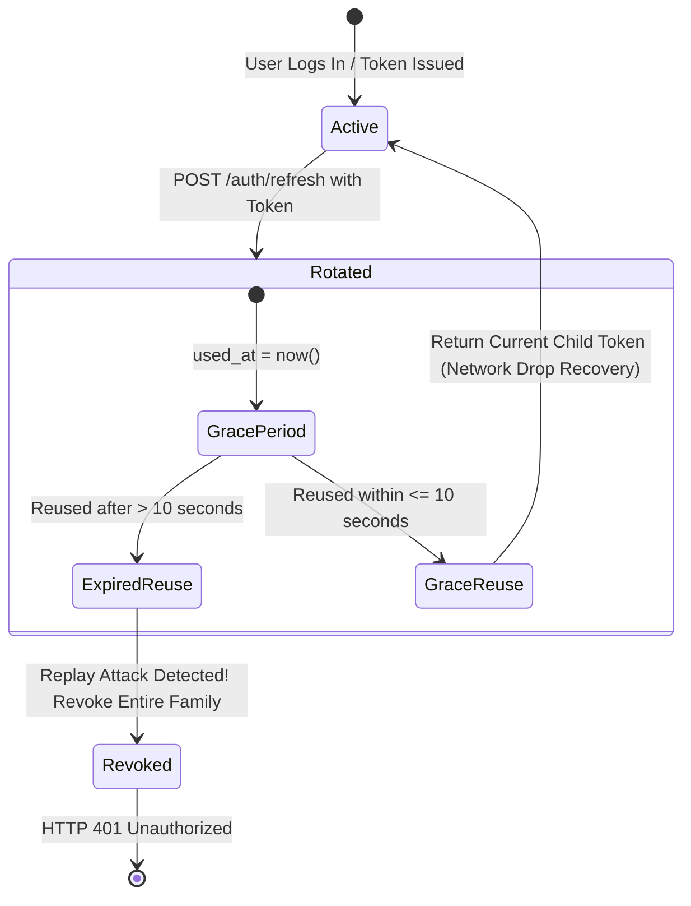

### Why

- **The Lost Response Refresh Storm:** On mobile cellular networks, a client frequently submits a refresh request, the server rotates the token, and commits the new token to the database. But before the HTTP response reaches the phone, the mobile connection drops.
- **The Catastrophic Lockout Without Grace Window:** When the phone reconnects 3 seconds later, it retransmits its original refresh token. In a strict rotation system without a grace window, the server observes a used token, concludes an attack has occurred, immediately revokes the family, and logs the shopkeeper out. In an offline-first app, unexpectedly logging a storekeeper out at the counter is catastrophic.

### Why Not

- **Why not Non-Rotating Refresh Tokens?**  
  A non-rotating refresh token that lives for 30 days provides an attacker who extracts it from an unencrypted backup a 30-day window of undetected access with no revocation capability.
- **Why not Long-Lived Access Tokens (e.g. 30-day JWT)?**  
  JWTs cannot be revoked without maintaining a distributed token blacklist, defeating the stateless benefit of JWTs.

---

## 15. Multi-Tenant Database Isolation: Composite Foreign Keys

### What

Database-level multi-tenancy enforcement where every tenant-scoped table includes `shop_id` in its primary key, and all foreign keys are **composite references** containing both `shop_id` and the referenced entity `id`.

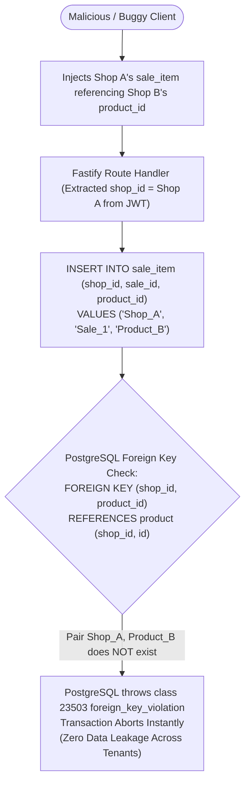

### Why

- **Elimination of Broken Object-Level Authorization (BOLA / IDOR):** BOLA occurs when an authenticated user of Shop A submits an API request referencing an entity ID belonging to Shop B.
- **Defense in Depth Beyond Application Code:** Relying solely on developer diligence to add `AND shop_id = req.user.shopId` to every single SQL query in every endpoint is guaranteed to fail eventually due to human error. With composite foreign keys, **the PostgreSQL database engine itself physically rejects cross-tenant references**.

### Why Not

- **Why not Separate Databases per Tenant?**  
  Managing tens of thousands of separate SQLite/PostgreSQL database instances for small retail shops creates immense DevOps overhead, makes cross-store analytics impossible, and wastes database connection pools.
- **Why not Relying Exclusively on Row-Level Security (RLS)?**  
  PostgreSQL RLS is powerful, but complex policies often degrade query planner efficiency, bypass indexes, and can be accidentally bypassed during superuser connections or complex joins. Composite foreign keys enforce mathematical isolation directly within the relational graph itself.

---

## 16. Query Safety & SQL Injection Defense: Allowlisted Patch Builders vs ORMs

### What

All database interactions use raw SQL through the native `pg` driver with parameterized queries (`$1, $2`). For dynamic `PATCH` endpoints where client requests contain an arbitrary subset of mutable fields, column names are mapped through a hardcoded TypeScript dictionary allowlist.

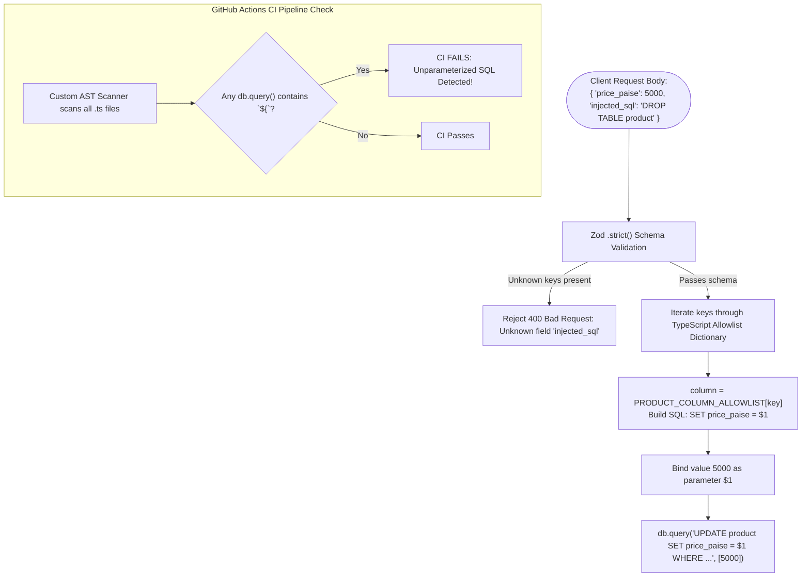

### Why

- **SQL Injection Vulnerability in Dynamic Patches:** When building an `UPDATE product SET ...` query from a JSON request body, developers frequently interpolate object keys directly into the SQL string.
- **Overhead and Obscurity of Heavy ORMs:** Heavy ORMs (Prisma, TypeORM) generate inefficient SQL, make row-level locking (`SELECT ... FOR UPDATE`) awkward or impossible, fail to properly model composite foreign keys, and add tens of megabytes of bloat to the Node.js runtime.

### Why Not

- **Why not Prisma ORM?**  
  Prisma uses a separate Rust query engine binary that increases cold-start times, lacks support for Postgres `FOR UPDATE` row locks in standard find methods, and generates nested subqueries that perform poorly on high-throughput sync batches.
- **Why not Query Builders like Knex?**  
  Knex adds an unnecessary abstraction layer over SQL. Hand-written SQL is universally readable, completely portable, and allows micro-optimizing queries and index usage without fighting the query builder's syntax.

---

## 17. Mobile Storage Engine: Hand-Written SQLite WAL vs WatermelonDB/Realm

### What

Direct integration with `expo-sqlite` utilizing raw, hand-crafted SQL schemas, version-controlled migrations via `PRAGMA user_version`, and Write-Ahead Logging (`PRAGMA journal_mode = WAL`).

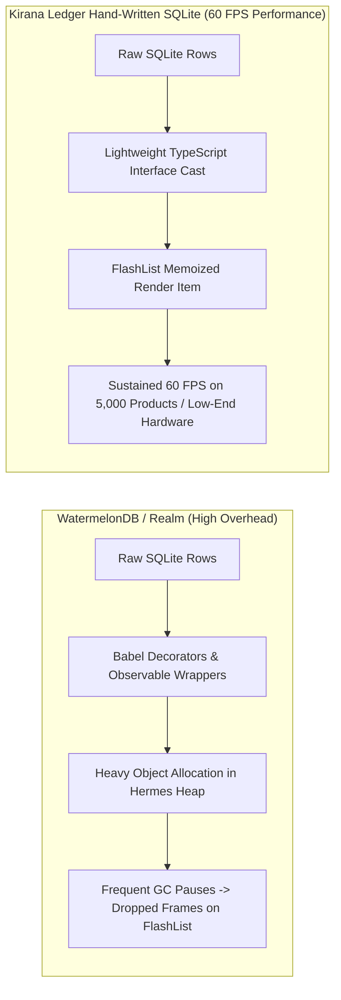

### Why

- **Performance on Low-End Android Hardware:** Low-end Android phones running in kirana shops have constrained CPU cores and limited RAM (2GB - 3GB). ORM abstractions allocate thousands of intermediate JavaScript objects during list reads, causing frequent Garbage Collector (GC) pauses and dropped frames during list scrolling.
- **Exact Transaction Control:** Offline sync requires strict, explicit control over when exclusive database transactions begin and commit. Hand-written SQL allows executing multi-table inserts, composite outbox enqueueing, and cursor updates within a single, explicit `BEGIN EXCLUSIVE` transaction block.

### Why Not

- **Why not WatermelonDB?**  
  WatermelonDB requires configuring Babel decorators, wraps models in complex Observable classes, has brittle synchronization hooks, and enforces opinionated data conventions that clash with custom event-sourced outbox engines.
- **Why not Realm (Mongo Realm)?**  
  Realm utilizes a proprietary C++ storage engine with significant binary size overhead (adding 15MB+ to the APK), has a history of engine crashes on low-end Android architectures, and locks the application into Realm-specific object bindings that prevent running headless sync tests in standard Node.js environments.
- **Why not AsyncStorage?**  
  AsyncStorage is a key-value string store. It cannot perform relational indexing, has no ACID transaction support, cannot compute mathematical sums across rows, and corrupts data when storing large datasets.

---

## 18. Android Native Diagnostics: Kotlin Module (Doze & App Standby Inspection)

### What

A custom native Kotlin module (`modules/device-health`) built with the Expo Modules API that directly interfaces with Android operating system system services:

- `UsageStatsManager.getAppStandbyBucket()`: Identifies the app's current OS standby bucket (`ACTIVE`, `WORKING_SET`, `FREQUENT`, `RARE`, `RESTRICTED`).
- `PowerManager.isDeviceIdleMode()`: Inspects whether Android is currently enforcing **Doze Mode**.
- `PowerManager.isIgnoringBatteryOptimizations()`: Inspects battery optimization exemption status.
- `ConnectivityManager.getRestrictBackgroundStatus()`: Inspects Data Saver status.
- `resolveDns(host)`: Times DNS lookup latency asynchronously on `Dispatchers.IO`.

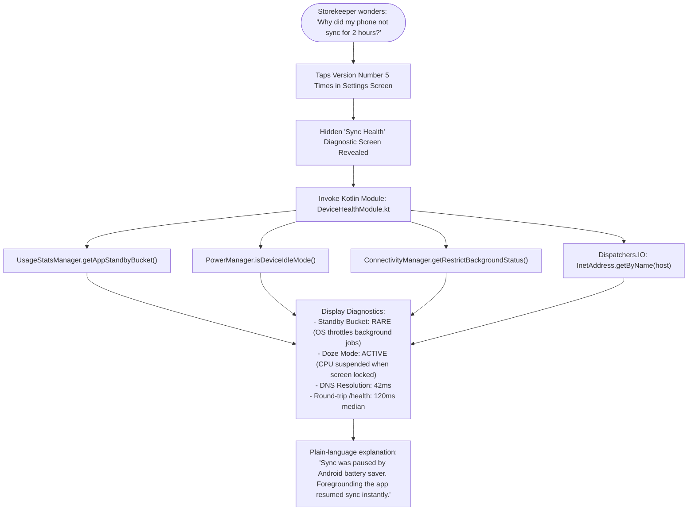

### Why

- **Demystifying "Sync Delays" for Shopkeepers & SDE-1 Interviewers:** On real Android devices, storekeepers often ask: _"Why did my phone not sync for 2 hours while it was locked on the counter?"_ The answer is not a bug in the React Native code; it is the Android OS **Doze Mode** and **App Standby Buckets** throttling background jobs and network radios to preserve battery.
- **Interview Differentiator:** Most React Native candidates have zero native platform depth and treat the mobile device as a browser. Implementing a custom Kotlin module demonstrating deep understanding of the Android lifecycle, OS power management constraints, and thread-safe native-to-JS bridging immediately establishes SDE-1 / SDE-2 technical credibility.

### Why Not

- **Why not standard `NetInfo` alone?**  
  `NetInfo` only reports whether the cellular or Wi-Fi radio has an active link. It cannot tell you if the Android OS has placed the app in the `RARE` App Standby bucket, restricted background data, or turned off background network access due to Doze Mode.
- **Why not prompting the user to disable battery optimizations?**  
  Google Play policy strictly restricts applications from requesting `REQUEST_IGNORE_BATTERY_OPTIMIZATIONS`. Apps that prompt users to disable battery optimizations without qualifying for specific exempt use cases face automatic rejection or removal from Google Play.

---

## 19. Summary Architectural Decision Matrix

| Architectural Problem      | Chosen Solution                        | Primary Benefit                                      | Rejected Alternative        | Why Rejected                                               |
| -------------------------- | -------------------------------------- | ---------------------------------------------------- | --------------------------- | ---------------------------------------------------------- |
| **Data Synchronization**   | Offline-First with Outbox Engine       | 0ms checkout latency, works 100% offline             | Cloud-First with HTTP Cache | Read-only; cannot stage relational transactions offline    |
| **Inventory / Balance**    | Append-Only Event Stream (`SUM`)       | Conflict-free multi-device merging                   | Mutable balance columns     | Concurrent offline sales silently overwrite decrements     |
| **Numeric Representation** | Integer Paise & Milli-units            | Exact mathematical precision, no rounding loss       | IEEE 754 Floats             | Accumulates rounding drift; fails balance reconciliation   |
| **Primary Keys**           | Client UUIDv7                          | Sequential B-tree locality, offline relational trees | Server Auto-Increment       | Cannot generate valid relational foreign keys offline      |
| **Sequence Ordering**      | Per-Shop Counter with Row Lock         | Eliminates out-of-order commit "missed rows"         | Global Postgres Sequence    | Sequence numbers commit out of order, skipping rows        |
| **Batch Resilience**       | Per-Op `SAVEPOINT` + Op Isolation      | Poison ops do not jam the sync queue                 | All-or-Nothing Batch        | Single malformed op halts all store sync permanently       |
| **Master Data Merge**      | `baseSeq` + `field_meta`               | Detects true concurrent field conflicts              | Pure Last-Writer-Wins       | Silently overwrites newer concurrent price/barcode edits   |
| **Pull Consistency**       | Op-Complete Pagination Boundary        | Prevents splitting sales from items across pages     | Fixed Row Limit             | Split pages cause foreign key crashes on client apply      |
| **Client Concurrency**     | SQLite Table Lease Row                 | Safe across foreground UI and background task        | In-Memory Mutex             | Fails across separate Hermes JavaScript runtimes           |
| **Stock Count Audit**      | Server Computes Delta from Sum         | Absolute inventory ground truth preserved            | Client Computes Delta       | Causes double-decrements if other sales occurred           |
| **Auth Token Security**    | Token Rotation + 10s Grace Window      | Protects against network drops on rotation           | Rotation without Grace      | Dropped response locks out legitimate storekeeper          |
| **Multi-Tenancy**          | Composite Foreign Keys `(shop_id, id)` | Database-level mathematical tenant isolation         | App-level `WHERE` clauses   | High risk of BOLA/IDOR vulnerabilities via human error     |
| **Query Safety**           | Allowlisted Patch Builder + Strict Zod | Bulletproof SQL injection prevention                 | Heavy ORMs (Prisma/TypeORM) | Massive runtime overhead; poor row-locking support         |
| **Mobile Storage**         | Hand-Crafted SQLite with WAL           | Maximum performance on low-end Android hardware      | WatermelonDB / Realm        | High memory allocation, GC pauses, binary bloat            |
| **OS Diagnostics**         | Native Kotlin Module (Expo API)        | Deep visibility into Doze & Standby Buckets          | Standard NetInfo            | Cannot detect Android OS power-saving network restrictions |
