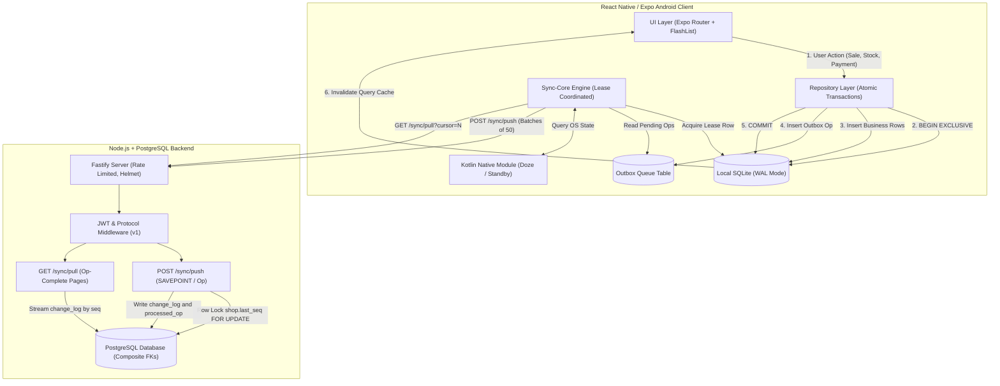
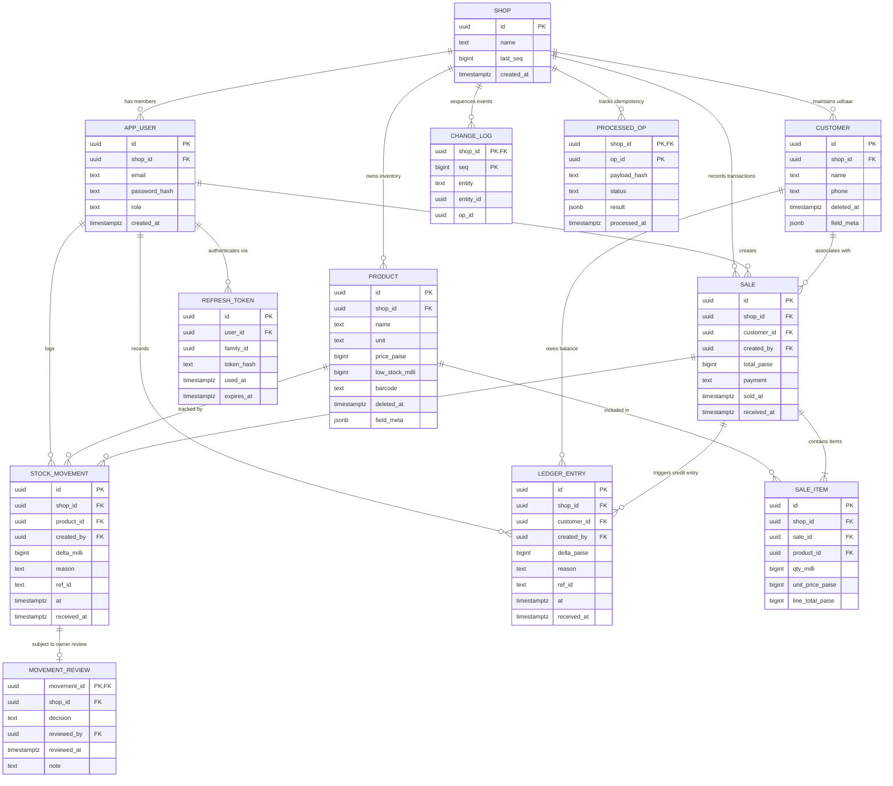
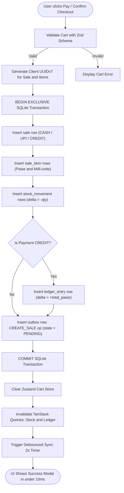
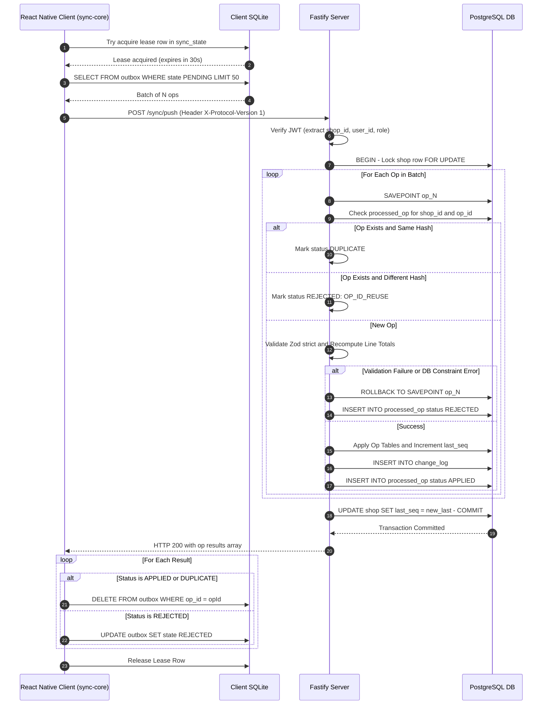
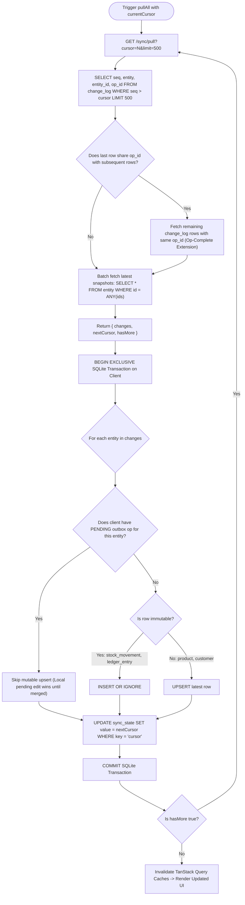
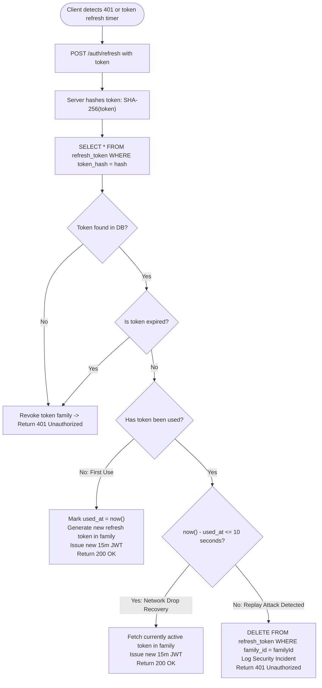
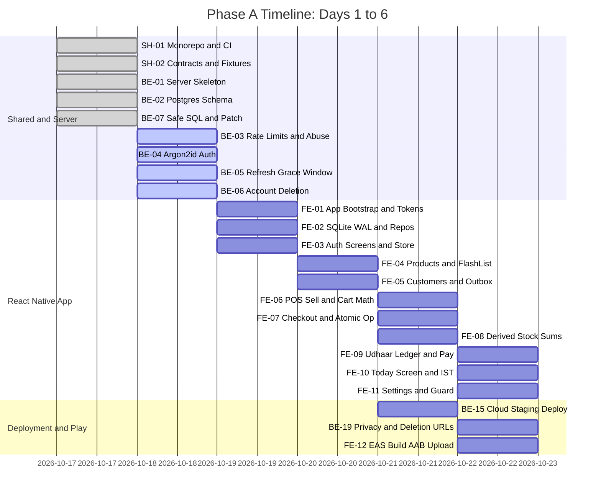
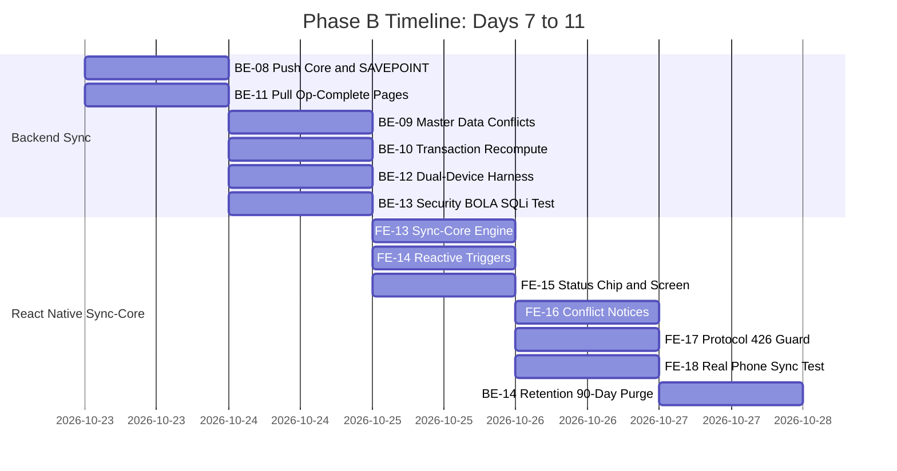
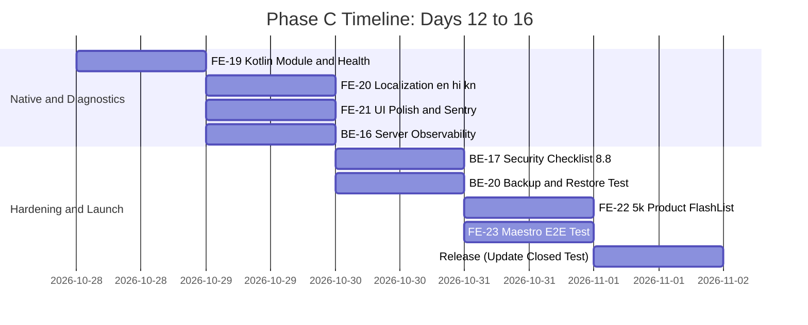

# Kirana Ledger: End-to-End Implementation Plan (React Native + Node.js)

**Target Project:** `Store-Ledger` (`d:/Desktop/Manager/Store-Ledger`)  
**Target Platform:** Android (Google Play Closed Testing) + Node.js/PostgreSQL Server  
**Frontend Framework:** React Native (Expo Development Builds, Expo Router, TypeScript Strict)  
**Backend Framework:** Node.js (Fastify, TypeScript Strict, PostgreSQL)  
**Architecture:** Offline-First, Event-Sourced / Append-Only Ledger, Outbox Sync Engine  
**Author:** Roshan Kumar  
**Source Specs:** `kirana-ledger-spec-v2.md` & `kirana-ledger-tickets-v2.md`

---

## 1. System Architecture & Topology

Kirana Ledger is engineered for 100% offline survivability on low-end Android hardware while enabling multi-device synchronization across 1 to 3 devices per retail shop when connectivity exists.

### 1.1 Architecture Flowchart



---

## 2. Complete Database Schemas & ER-Diagram

The database model is strictly bifurcated:

- **Client (SQLite):** Flat relational schema with no foreign key enforcement or enum CHECKs on synced tables (preventing mid-sync crash on split batches).
- **Server (PostgreSQL):** Fully constrained, composite foreign keys `(shop_id, id)` ensuring mathematical tenant isolation, JSONB field metadata for conflict detection, and immutable audit logs.

### 2.1 Database ER-Diagram



---

### 2.2 Client Database Schema (SQLite)

Executed on app initialization via `PRAGMA user_version` migrations in `apps/mobile/src/db/`:

```sql
PRAGMA journal_mode = WAL;
PRAGMA synchronous = NORMAL;

-- Master data: Product
CREATE TABLE IF NOT EXISTS product (
  id TEXT PRIMARY KEY,
  name TEXT NOT NULL,
  unit TEXT NOT NULL,
  price_paise INTEGER NOT NULL CHECK (price_paise >= 0),
  low_stock_milli INTEGER NOT NULL DEFAULT 0,
  barcode TEXT,
  deleted_at INTEGER
);

-- Master data: Customer
CREATE TABLE IF NOT EXISTS customer (
  id TEXT PRIMARY KEY,
  name TEXT NOT NULL,
  phone TEXT,
  deleted_at INTEGER
);

-- Sales transactions
CREATE TABLE IF NOT EXISTS sale (
  id TEXT PRIMARY KEY,
  customer_id TEXT,
  created_by TEXT NOT NULL,
  total_paise INTEGER NOT NULL CHECK (total_paise >= 0),
  payment TEXT NOT NULL,
  sold_at INTEGER NOT NULL
);

CREATE TABLE IF NOT EXISTS sale_item (
  id TEXT PRIMARY KEY,
  sale_id TEXT NOT NULL,
  product_id TEXT NOT NULL,
  qty_milli INTEGER NOT NULL CHECK (qty_milli > 0),
  unit_price_paise INTEGER NOT NULL,
  line_total_paise INTEGER NOT NULL
);

-- Append-only Inventory Ledger (Never modified or deleted)
CREATE TABLE IF NOT EXISTS stock_movement (
  id TEXT PRIMARY KEY,
  product_id TEXT NOT NULL,
  created_by TEXT NOT NULL,
  delta_milli INTEGER NOT NULL CHECK (delta_milli <> 0),
  reason TEXT NOT NULL,
  ref_id TEXT,
  at INTEGER NOT NULL
);

-- Append-only Udhaar Customer Ledger (Never modified or deleted)
CREATE TABLE IF NOT EXISTS ledger_entry (
  id TEXT PRIMARY KEY,
  customer_id TEXT NOT NULL,
  created_by TEXT NOT NULL,
  delta_paise INTEGER NOT NULL CHECK (delta_paise <> 0),
  reason TEXT NOT NULL,
  ref_id TEXT,
  at INTEGER NOT NULL
);

-- Employee movement review (for staff approvals)
CREATE TABLE IF NOT EXISTS movement_review (
  movement_id TEXT PRIMARY KEY,
  decision TEXT NOT NULL,
  reviewed_by TEXT NOT NULL,
  reviewed_at INTEGER NOT NULL,
  note TEXT
);

-- Indexes for lightning fast derived sums and lookups
CREATE INDEX IF NOT EXISTS ix_sm_product ON stock_movement(product_id);
CREATE INDEX IF NOT EXISTS ix_le_customer ON ledger_entry(customer_id);
CREATE INDEX IF NOT EXISTS ix_si_sale ON sale_item(sale_id);
CREATE INDEX IF NOT EXISTS ix_sale_time ON sale(sold_at);

-- Outbox Queue: Stages mutations for synchronization
CREATE TABLE IF NOT EXISTS outbox (
  local_seq INTEGER PRIMARY KEY AUTOINCREMENT,
  op_id TEXT NOT NULL UNIQUE,
  type TEXT NOT NULL,
  payload TEXT NOT NULL,
  state TEXT NOT NULL DEFAULT 'PENDING', -- PENDING | REJECTED | STUCK
  attempts INTEGER NOT NULL DEFAULT 0,
  next_retry_at INTEGER NOT NULL DEFAULT 0,
  last_error TEXT
);

-- Synchronization metadata & distributed lease row
CREATE TABLE IF NOT EXISTS sync_state (
  key TEXT PRIMARY KEY,
  value TEXT NOT NULL -- cursor, device_id, sync_lease
);

-- Diagnostics and Sync Health log
CREATE TABLE IF NOT EXISTS sync_log (
  id INTEGER PRIMARY KEY AUTOINCREMENT,
  started_at INTEGER,
  duration_ms INTEGER,
  pushed INTEGER,
  pulled INTEGER,
  bytes INTEGER,
  error TEXT
);
```

---

### 2.3 Server Database Schema (PostgreSQL)

Executed via plain SQL migrations in `apps/server/src/migrations/`:

```sql
CREATE EXTENSION IF NOT EXISTS "uuid-ossp";

-- Tenant entity: Kirana Shop
CREATE TABLE shop (
  id uuid PRIMARY KEY,
  name text NOT NULL CHECK (char_length(name) BETWEEN 1 AND 120),
  last_seq bigint NOT NULL DEFAULT 0,
  created_at timestamptz NOT NULL DEFAULT now()
);

-- Users / Store owners
CREATE TABLE app_user (
  id uuid PRIMARY KEY,
  shop_id uuid NOT NULL REFERENCES shop(id) ON DELETE CASCADE,
  email text NOT NULL CHECK (char_length(email) <= 254),
  password_hash text NOT NULL,
  role text NOT NULL DEFAULT 'OWNER' CHECK (role IN ('OWNER','EMPLOYEE')),
  created_at timestamptz NOT NULL DEFAULT now(),
  UNIQUE (shop_id, id)
);
CREATE UNIQUE INDEX ux_user_email ON app_user (lower(email));

-- Rotating refresh tokens with SHA-256 storage
CREATE TABLE refresh_token (
  id uuid PRIMARY KEY,
  user_id uuid NOT NULL REFERENCES app_user(id) ON DELETE CASCADE,
  family_id uuid NOT NULL,
  token_hash text NOT NULL,
  used_at timestamptz,
  expires_at timestamptz NOT NULL
);
CREATE INDEX ix_rt_hash ON refresh_token (token_hash);

-- Tenant-isolated Product table with composite keys
CREATE TABLE product (
  id uuid PRIMARY KEY,
  shop_id uuid NOT NULL REFERENCES shop(id) ON DELETE CASCADE,
  name text NOT NULL CHECK (char_length(name) BETWEEN 1 AND 120),
  unit text NOT NULL CHECK (unit IN ('pc','kg','l')),
  price_paise bigint NOT NULL CHECK (price_paise BETWEEN 0 AND 100000000),
  low_stock_milli bigint NOT NULL DEFAULT 0 CHECK (low_stock_milli >= 0),
  barcode text CHECK (char_length(barcode) <= 64),
  deleted_at timestamptz,
  field_meta jsonb NOT NULL DEFAULT '{}',
  UNIQUE (shop_id, id)
);

-- Tenant-isolated Customer table with composite keys
CREATE TABLE customer (
  id uuid PRIMARY KEY,
  shop_id uuid NOT NULL REFERENCES shop(id) ON DELETE CASCADE,
  name text NOT NULL CHECK (char_length(name) BETWEEN 1 AND 120),
  phone text CHECK (char_length(phone) <= 20),
  deleted_at timestamptz,
  field_meta jsonb NOT NULL DEFAULT '{}',
  UNIQUE (shop_id, id)
);

-- Sales records with composite foreign keys
CREATE TABLE sale (
  id uuid PRIMARY KEY,
  shop_id uuid NOT NULL REFERENCES shop(id) ON DELETE CASCADE,
  customer_id uuid,
  created_by uuid NOT NULL,
  total_paise bigint NOT NULL CHECK (total_paise BETWEEN 0 AND 100000000),
  payment text NOT NULL CHECK (payment IN ('CASH','UPI','CREDIT')),
  sold_at timestamptz NOT NULL,
  received_at timestamptz NOT NULL DEFAULT now(),
  UNIQUE (shop_id, id),
  FOREIGN KEY (shop_id, customer_id) REFERENCES customer (shop_id, id),
  FOREIGN KEY (shop_id, created_by) REFERENCES app_user (shop_id, id)
);
CREATE INDEX ix_sale_shop_time ON sale(shop_id, sold_at);

-- Line items with composite foreign keys
CREATE TABLE sale_item (
  id uuid PRIMARY KEY,
  shop_id uuid NOT NULL,
  sale_id uuid NOT NULL,
  product_id uuid NOT NULL,
  qty_milli bigint NOT NULL CHECK (qty_milli > 0),
  unit_price_paise bigint NOT NULL CHECK (unit_price_paise >= 0),
  line_total_paise bigint NOT NULL CHECK (line_total_paise >= 0),
  FOREIGN KEY (shop_id, sale_id) REFERENCES sale (shop_id, id) ON DELETE CASCADE,
  FOREIGN KEY (shop_id, product_id) REFERENCES product (shop_id, id)
);
CREATE INDEX ix_sale_item_sale ON sale_item(sale_id);

-- Immutable stock movements
CREATE TABLE stock_movement (
  id uuid PRIMARY KEY,
  shop_id uuid NOT NULL REFERENCES shop(id) ON DELETE CASCADE,
  product_id uuid NOT NULL,
  created_by uuid NOT NULL,
  delta_milli bigint NOT NULL CHECK (delta_milli <> 0),
  reason text NOT NULL CHECK (reason IN ('SALE','PURCHASE','ADJUSTMENT','COUNT')),
  ref_id text,
  at timestamptz NOT NULL,
  received_at timestamptz NOT NULL DEFAULT now(),
  UNIQUE (shop_id, id),
  FOREIGN KEY (shop_id, product_id) REFERENCES product (shop_id, id),
  FOREIGN KEY (shop_id, created_by) REFERENCES app_user (shop_id, id)
);
CREATE INDEX ix_sm_shop_product ON stock_movement(shop_id, product_id);

-- Immutable udhaar ledger
CREATE TABLE ledger_entry (
  id uuid PRIMARY KEY,
  shop_id uuid NOT NULL REFERENCES shop(id) ON DELETE CASCADE,
  customer_id uuid NOT NULL,
  created_by uuid NOT NULL,
  delta_paise bigint NOT NULL CHECK (delta_paise <> 0),
  reason text NOT NULL CHECK (reason IN ('CREDIT_SALE','PAYMENT','ADJUSTMENT')),
  ref_id text,
  at timestamptz NOT NULL,
  received_at timestamptz NOT NULL DEFAULT now(),
  UNIQUE (shop_id, id),
  FOREIGN KEY (shop_id, customer_id) REFERENCES customer (shop_id, id),
  FOREIGN KEY (shop_id, created_by) REFERENCES app_user (shop_id, id)
);
CREATE INDEX ix_le_shop_customer ON ledger_entry(shop_id, customer_id);

-- Review records for stock movements
CREATE TABLE movement_review (
  movement_id uuid PRIMARY KEY,
  shop_id uuid NOT NULL,
  decision text NOT NULL CHECK (decision IN ('APPROVED','REJECTED')),
  reviewed_by uuid NOT NULL,
  reviewed_at timestamptz NOT NULL DEFAULT now(),
  note text,
  FOREIGN KEY (shop_id, movement_id) REFERENCES stock_movement (shop_id, id) ON DELETE CASCADE,
  FOREIGN KEY (shop_id, reviewed_by) REFERENCES app_user (shop_id, id)
);

-- Monotonic change log sequence per shop
CREATE TABLE change_log (
  shop_id uuid NOT NULL REFERENCES shop(id) ON DELETE CASCADE,
  seq bigint NOT NULL,
  entity text NOT NULL,
  entity_id uuid NOT NULL,
  op_id uuid NOT NULL,
  PRIMARY KEY (shop_id, seq)
);
CREATE INDEX ix_cl_op ON change_log (shop_id, op_id);

-- Processed operations for idempotency and replay protection
CREATE TABLE processed_op (
  shop_id uuid NOT NULL REFERENCES shop(id) ON DELETE CASCADE,
  op_id uuid NOT NULL,
  payload_hash text NOT NULL,
  status text NOT NULL CHECK (status IN ('APPLIED','REJECTED','DUPLICATE')),
  result jsonb NOT NULL,
  processed_at timestamptz NOT NULL DEFAULT now(),
  PRIMARY KEY (shop_id, op_id)
);
```

---

## 3. Operational Workflows & Flowcharts

### 3.1 Local Checkout & Outbox Transaction Flowchart

Every counter checkout commits all business changes and the corresponding outbox sync operation in **one exclusive SQLite transaction**.



---

### 3.2 Outbox Processing & Server Push Flowchart

The background sync engine pushes pending ops in batches of up to 50 operations. The server processes each operation inside an individual `SAVEPOINT` to isolate poison ops.



---

### 3.3 Pull Synchronization & Op-Complete Paging Flowchart

Pull pagination streams change logs from the server. If the 500-row page limit cuts through the middle of an operation (e.g. sale items), the server extends the page boundary to preserve relational atomicity.



---

### 3.4 Auth Token Rotation & 10-Second Grace Window

Handles network drops occurring precisely when the server rotates refresh tokens, preventing accidental shopkeeper lockouts.



---

## 4. Phase-by-Phase Ticket Execution Roadmap

### Phase A: Standalone Offline Kirana Engine (Days 1 to 6)

_Target: 100% operational offline React Native APK with local SQLite, cart calculation, udhaar ledger, and cloud auth deployed to closed testing._



---

### Phase B: Cloud Sync Engine & Dual-Device Convergence (Days 7 to 11)

_Target: Bidirectional sync with sequence locks, SAVEPOINT poison-op isolation, field-level conflict detection, and physical multi-device convergence._



---

### Phase C: Android Native Deep Integration & Security Hardening (Days 12 to 16)

_Target: Kotlin Expo module for OS Doze/Standby inspection, English/Hindi/Kannada localization, Sentry PII scrubbing, 5,000-product performance pass, and Maestro E2E test._



---

## 5. Detailed Ticket Breakdown & Acceptance Criteria

### 5.1 Shared Contract Tickets

- **SH-01: Monorepo, Tooling & CI**
  - Setup `pnpm` workspaces: `apps/mobile`, `apps/server`, `packages/shared`, `packages/sync-core`.
  - Base TypeScript strict configurations (`tsconfig.base.json`).
  - GitHub Actions CI workflow: runs linting, typechecking, unit tests, and security audits.
  - Custom CI AST rule: Fails if any `db.query(` contains string template interpolation (`${`).
- **SH-02: Shared Contract Package**
  - Define Zod `.strict()` schemas for all 10 op payloads: `PRODUCT_CREATE`, `PRODUCT_PATCH`, `PRODUCT_DELETE`, `CUSTOMER_CREATE`, `CUSTOMER_PATCH`, `CUSTOMER_DELETE`, `CREATE_SALE`, `ADD_STOCK`, `STOCK_COUNT`, `RECORD_PAYMENT`.
  - Export protocol constants: `PROTOCOL_VERSION = 1`, reject reason codes (`VALIDATION`, `TOTAL_MISMATCH`, `OP_ID_REUSE`, `CONSTRAINT`, `FORBIDDEN`).
  - Store JSON test fixtures in `packages/shared/fixtures/` for valid and invalid payloads.

### 5.2 Backend Tickets (Fastify + PostgreSQL)

- **BE-01: Server Skeleton & Middleware:** Fastify, Zod environment validation, Helmet, 1 MB request cap, request-ID structured logger, `GET /health`.
- **BE-02: PostgreSQL Migrations & Composite Schema:** Ordered SQL migrations, composite foreign keys `(shop_id, id)`, application role with no DDL rights and 5s query timeout.
- **BE-07: Safe SQL Layer & Patch Builder:** Query helper, strict allowlist mapping for dynamic patch updates, parameter binding for all values.
- **BE-03: Rate Limiting & Semaphore:** `@fastify/rate-limit` (auth: 10/min IP, 5/min email; push: 60/min user), argon2 concurrency semaphore (cap: 4).
- **BE-04: Argon2id Auth Endpoints:** Register and login with argon2id (19 MiB, 2 iterations, 1 lane), 15-minute pinned JWT (`HS256`), uniform timing for failed logins.
- **BE-05: Refresh Token Rotation & 10s Grace:** SHA-256 token storage, family reuse revocation, 10-second grace window for dropped network retries.
- **BE-06: Account Deletion (`DELETE /account`):** Single transaction cascade deleting shop and all associated data, verified by zero-row assertion.
- **BE-15 / BE-19: Cloud Staging Deploy:** Staging deployment over HTTPS, non-public database, public privacy policy and account deletion pages.
- **BE-08: Push Endpoint Core (`POST /sync/push`):** Header `X-Protocol-Version: 1`, shop row lock on `last_seq`, individual `SAVEPOINT` per op, idempotency check via `processed_op`.
- **BE-09: Master Data Handlers & Conflicts:** `baseSeq` vs `field_meta` check, field-level conflict detection, sticky tombstones for deleted records.
- **BE-10: Transaction Ops & Server Recomputation:** Recalculate line totals (`round_half_up`) and sale total, verify 1:1 negative stock movement match, calculate `STOCK_COUNT` delta against current server sum.
- **BE-11: Pull Endpoint (`GET /sync/pull`):** Sequence-based change log streaming, op-complete boundary extension (never splits sales from line items).
- **BE-12 / BE-13: Sync Integration & Security Suites:** Jest tests for 2 simulated devices, 10 spec convergence scenarios, BOLA cross-tenant attack tests, SQL injection payloads.
- **BE-14: Retention Cleanup Job:** Automated 90-day purge of `processed_op`.
- **BE-16 / BE-17 / BE-20: Hardening, Observability & Backups:** Sentry PII scrubbing, 12-item pre-launch security audit walkthrough, database restore verification.

### 5.3 Frontend Tickets (React Native + Expo)

- **FE-01: App Bootstrap & Design System:** Expo development build, Expo Router, theme tokens (`#1F7A4D`, `#E8A317`), Zustand session store.
- **FE-02: SQLite WAL Engine & Repositories:** `expo-sqlite` with `PRAGMA journal_mode = WAL`, exclusive transaction wrapper, versioned migrations (`PRAGMA user_version`), repository pattern.
- **FE-03: Auth Screens & Secure Storage:** Login/Register screens, `expo-secure-store` Keystore storage, offline launch restoration, single-flight refresh wrapper.
- **FE-04: Product Management:** FlashList with 150ms debounced search (`LIKE ? ESCAPE '\'`), product form sheet, atomic outbox enqueueing with `baseSeq`.
- **FE-05: Customer Management:** Customer list, customer form sheet, soft deletion (`deleted_at`), outbox ops.
- **FE-06: Point-of-Sale Sell Screen:** Frequent-item chips, cart with steppers, fractional milli-unit quantities (e.g. 0.250 kg), exact paise rounding math.
- **FE-07: Checkout Sheet & Atomic Sale Op:** Cash/UPI/Credit selection, atomic transaction (sale + items + stock movements + ledger entry + `CREATE_SALE` outbox op).
- **FE-08: Derived Stock Views & Sheets:** `SUM(delta_milli)` derived stock query, stock-in sheet (`ADD_STOCK`), physical count sheet (`STOCK_COUNT` with `countedMilli`).
- **FE-09: Udhaar Ledger & Payment Sheet:** Customer balance list (`SUM(delta_paise)`), payment collection sheet (`RECORD_PAYMENT`).
- **FE-10: Today Dashboard & IST Boundaries:** Sales totals, credit extended, low stock alerts, deterministic IST day calculation.
- **FE-11: Settings & Logout Guard:** Language picker, pending outbox logout blocker, account deletion flow, version tap-5x diagnostic trigger.
- **FE-12: Closed-Test Release Build (AAB):** `eas.json` configuration, `android:allowBackup="false"`, signed AAB upload to Google Play closed testing track.
- **FE-13: `sync-core` Client Engine:** DB lease row lock, batched `pushAll()`, op-complete `pullAll()`, exponential backoff with jitter, op isolation (single dispatch on 5xx).
- **FE-14: Sync Triggers & Adapters:** NetInfo link restoration, AppState foregrounding, 2s local write debounce, 5-minute foreground interval.
- **FE-15: Status Chip & Sync Status Screen:** Header chip (_All saved_, _N waiting_, _Syncing_, _Needs attention_), detailed op status list with human-readable error reasons.
- **FE-16: Conflict Notification Handling:** Display non-intrusive conflict banners when incoming patches supersede local edits.
- **FE-17: Protocol Version & 426 Guard:** Handle HTTP 426 Upgrade Required, render non-dismissible update prompt while keeping local data safe.
- **FE-18: Real-Device Sync Convergence Test:** Verification across physical Android hardware.
- **FE-19: Kotlin Native Module (`device-health`):** Bridges `UsageStatsManager`, `PowerManager` (Doze), `ConnectivityManager`, and async DNS probe into hidden Sync Health screen.
- **FE-20: Localization (en, hi, kn):** Dictionaries for English, Hindi, Kannada, Indian currency formatting (`₹1,23,456.78`).
- **FE-21: Polish, Accessibility & PII Scrubbing:** 44px touch targets, font scaling to 200%, Sentry PII sanitization.
- **FE-22 / FE-23: Performance Benchmark & Maestro E2E:** 5,000-product 60 FPS FlashList benchmark, Maestro airplane-mode sale automation.
